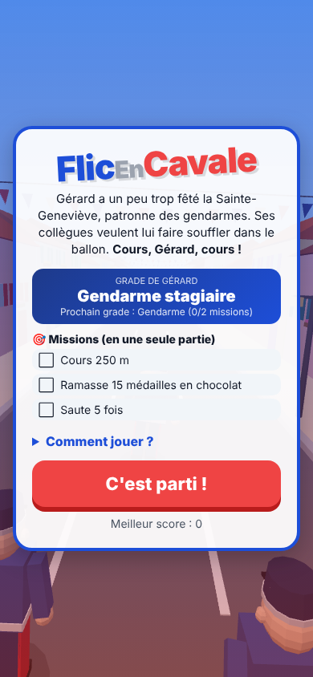
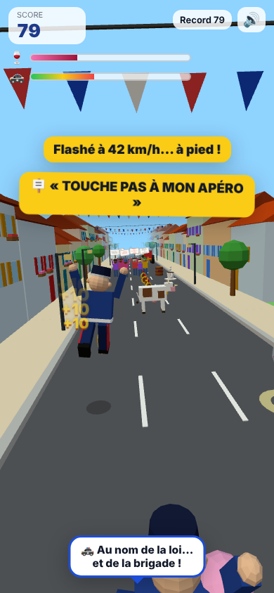
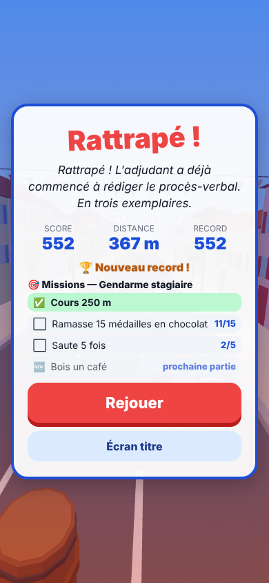

# 1. Positionnement, cible, risques et messages

> Document de la session MARKETING. Il sert de référence pour tout ce qu'on publie
> sur FlicEnCavale (vidéos, posts, fiches de store, mails à la presse).

## 1.1 Ce qu'est le jeu (vu en y jouant)

- **Un « endless runner » 3D vertical** (3 voies, glisser gauche/droite/haut/bas), dans une
  rue de village français pavoisée de fanions, avec ses maisons colorées et ses platanes.
- **Gérard**, gendarme en uniforme bleu et képi, fuit ses collègues qui lui crient dans des
  bulles : « Gérard, souffle dans le ballon, ça ne fait pas mal ! », « Reviens, il reste du gâteau ! ».
- **Des obstacles typiquement français et absurdes** : vache, tracteur, rond-point, baguette
  géante, panneau « Cédez le passage », radar (« Flashé à 42 km/h… à pied ! »), flaque de
  pastis, cortège de manifestants avec pancartes (« LIBÉREZ GÉRARD ! », « MOINS DE PV, PLUS DE PÉTANQUE ! »).
- **Beaucoup de texte drôle** à l'écran : c'est la vraie signature du jeu.
- **Méta-progression** : missions (« Bois un café », « Contourne 3 manifs ») et grades de
  Gendarme stagiaire à Général.
- **Gratuit, sans installation, sans compte**, une partie dure 1 à 3 minutes.

Captures de référence : [`captures/`](captures/).

| Écran titre | En course | Fin de partie |
| --- | --- | --- |
|  |  |  |

## 1.2 Positionnement en une phrase

> **FlicEnCavale, c'est le « Gendarme de Saint-Tropez » version jeu mobile :
> une course-poursuite burlesque et 100 % franchouillarde, qu'on lance en 2 secondes
> et qu'on fait tourner à toute la famille.**

Ce qui le différencie des milliers d'autres « runners » (Subway Surfers, Temple Run…) :

1. **L'humour français du quotidien** : vaches, ronds-points, manifs, baguette, pastis,
   procès-verbal en trois exemplaires. Un Français le reconnaît en une seconde ; c'est ce qui
   fait commenter (« c'est exactement mon village »).
2. **Le gendarme fuyard** : le renversement (c'est le gendarme qui est poursuivi) est
   immédiatement drôle et se raconte en une ligne.
3. **Jouable tout de suite dans le navigateur** : pas de store, pas de pub, pas de compte.
   On clique sur le lien, on joue.

## 1.3 Cible

| Cible | Pourquoi | Où la toucher |
| --- | --- | --- |
| **Cœur : 18-35 ans français**, joueurs occasionnels sur téléphone | Ils comprennent toutes les références, partagent des mèmes, jouent dans les transports | TikTok, Instagram Reels, Reddit FR, Discord, groupes WhatsApp |
| **Secondaire : 35-60 ans** « culture Gendarme de Saint-Tropez / Louis de Funès » | Nostalgie du comique troupier, partagent sur Facebook | Facebook, YouTube Shorts, presse régionale |
| **Bonus : familles** (parents + ados 12-17 ans) | Le jeu est gentil, sans violence | Bouche-à-oreille ; **on ne cible pas activement les enfants** (voir risques) |
| **Niche : gendarmes, policiers, pompiers, militaires** (et leurs proches) | Ils adorent l'autodérision sur leur métier… à condition que ce soit bienveillant | Bouche-à-oreille uniquement, jamais de démarchage « officiel » |

**Langue** : le jeu est en français, donc on vise la **France, la Belgique, la Suisse romande
et le Québec**. Pour l'international (portails CrazyGames/Poki), il faudra une traduction
(voir [04-viralite-suggestions.md](04-viralite-suggestions.md)).

## 1.4 ⚠️ Risques d'image et de modération (à lire absolument)

Le sujet « alcool + gendarmerie » est le **principal atout comique** du jeu… et son
**principal risque**. Voici les risques, du plus au moins important, et comment les gérer.

### Risque 1 — Plateformes vidéo : contenu « alcool » moins diffusé, voire retiré

- **TikTok, Instagram et YouTube** limitent la diffusion des contenus qui *présentent la
  consommation d'alcool de façon positive*, surtout s'ils peuvent toucher des mineurs.
  Une vidéo n'est pas forcément supprimée, mais elle peut être **écartée du fil « Pour toi »**
  sans qu'on soit prévenu (on parle de « shadowban » : les vues plafonnent à quelques centaines).
- **La publicité payante** (TikTok Ads, Meta Ads, Google Ads) est encore plus stricte : toute
  pub qui *montre* de l'alcool est soumise à des règles particulières (ciblage 18+, interdiction
  dans certains pays) et risque d'être refusée par la modération automatique.

**Ce qu'on fait :**
- Dans les vidéos et visuels, **on montre la poursuite, les vaches, les manifs, la baguette,
  le radar** — pas le verre de vin. Le verre de rouge n'apparaît jamais en gros plan ni en vignette.
- On **parle de l'alcool par allusion** (« pompette », « souffler dans le ballon »,
  « après la fête de la brigade ») plutôt que de le montrer.
- On met en avant que **l'alcool est un handicap dans le jeu** : plus Gérard a bu, plus il
  titube et plus il se fait rattraper ; le **café** le sauve. C'est vrai mécaniquement et c'est
  le bon message.
- On **n'utilise pas les hashtags** liés à l'alcool (#apéro, #vin, #beaujolais, #pastis, #ivre).
- Pas de publicité payante tant qu'on n'a pas vérifié qu'une pub *sans aucun visuel d'alcool*
  passe la modération (test à 5-10 €).

### Risque 2 — Loi Évin (France)

La loi Évin encadre **la publicité pour les boissons alcoolisées**. FlicEnCavale n'est **pas**
une publicité pour une boisson : aucune marque, aucun produit vendu. Le risque juridique est
donc **faible**, mais :
- **Ne jamais citer de marque** d'alcool (ni dans le jeu ni dans la com : pas de « Ricard »,
  « Pastis 51 », etc. — le jeu dit « pastis », c'est très bien).
- **Ne jamais associer la boisson à la réussite** dans la com (« bois du rouge pour faire
  plus de points ! » → interdit chez nous ; préférer « le café, c'est la vie »).
- Un clin d'œil du type **« À consommer avec modération… le jeu aussi »** dans la description
  est bienvenu (le jeu le fait déjà dans une mission : « Bois 2 verres de rouge (avec modération) »).

### Risque 3 — Classification d'âge sur les stores (pour plus tard)

Sur Google Play et l'App Store, on remplit un questionnaire de classification (IARC/PEGI pour
Google, questionnaire Apple pour l'App Store). **Un personnage jouable qui boit de l'alcool
et en tire un bénéfice (des points) fait généralement monter la classification** — souvent
**12+**, parfois **16+ (PEGI)** selon les réponses. Ça ne bloque pas la publication, mais :
- Le jeu **ne pourra probablement pas être présenté comme « pour enfants »** (catégorie
  « Famille » de Google Play = règles beaucoup plus strictes, à éviter).
- **Option à discuter avec les sessions CODE/DESIGN** pour la version store : faire du verre de
  rouge un objet *purement négatif* (ivresse, aucun point) ou le remplacer par un objet neutre.
  À décider le moment venu ; pas urgent pour la version web.
- Formulation dans la com : **« tout public, humour bon enfant »** plutôt que « pour enfants ».

### Risque 4 — Image de la Gendarmerie nationale

- **Ne jamais utiliser** : le logo officiel de la Gendarmerie (la grenade enflammée), la
  marque « Gendarmerie nationale », le bleu-blanc-rouge officiel de leurs visuels, ni laisser
  croire à un partenariat. Le jeu actuel n'en utilise pas : c'est parfait, on garde ça.
- **Toujours rester bienveillant** : Gérard est un brave type, ses collègues veulent son bien
  (« C'est pour ton bien, Gérard ! »). Le jeu se moque gentiment, il ne dénigre pas. C'est
  la tradition du comique troupier, et c'est ce qui le rend partageable *par les gendarmes eux-mêmes*.
- **Pas de taguage des comptes officiels** (@Gendarmerie, etc.) au lancement. Si le jeu marche
  et que leur community manager (connu pour son humour) le repère, tant mieux — mais on ne force pas.
- Ajouter dans la description : *« Jeu parodique. Aucun lien avec la Gendarmerie nationale.
  Aucun gendarme n'a soufflé dans un ballon pendant le développement. »*

### Risque 5 — Lecture politique (forces de l'ordre + manifestations)

Le sujet police/manifs est **sensible en France**. Les manifestants du jeu sont gentils et
absurdes (« PRIORITÉ AUX PIÉTONS (ET AUX VACHES) »), Gérard dit « Non, je ne viens pas
disperser la manif ! » : c'est **apolitique et ça doit le rester**.
- **Ne jamais rebondir sur l'actualité** (une manif réelle, une affaire de violences policières,
  une réforme). Même pour faire le buzz : c'est le meilleur moyen de se faire lyncher dans les commentaires.
- **Ne jamais répondre aux commentaires politiques** ; les masquer s'ils sont insultants
  (TikTok et Instagram permettent de filtrer des mots-clés dans les commentaires :
  Paramètres → Confidentialité → Commentaires → Filtrer les mots-clés).
- Préparer une réponse type, calme et drôle : *« Gérard ne fait pas de politique, il fait du
  footing réglementaire 🏃‍♂️ »*.

### Risque 6 — Calendrier : périodes à éviter ou à manier avec soin

- **Beaujolais nouveau (jeudi 19 novembre 2026)** : tentant, mais c'est de la promotion
  directe d'une boisson → **on ne l'exploite pas**.
- **Fêtes de fin d'année / « pots de Noël »** : thème « Gérard au pot de Noël de la brigade »
  OK *si* le message reste « le café sauve Gérard ».
- **Campagnes de Sécurité routière** (Noël, Nouvel An) : on ne fait **jamais** de lien avec la
  conduite. Gérard est **à pied**, c'est important. Phrase utile : *« Gérard ne conduit pas, il court. »*
- **Dry January** (janvier) : peut devenir un clin d'œil (« Gérard au café pour tout janvier »).

### Résumé des règles de com (à garder sous les yeux)

| ✅ On fait | ❌ On ne fait pas |
| --- | --- |
| Montrer la poursuite, les vaches, les manifs, le radar, la baguette | Montrer le verre de vin en gros plan / en vignette |
| Allusions : « pompette », « souffler dans le ballon » | Hashtags alcool, noms de marques |
| « Le café sauve Gérard » | « Bois du rouge pour faire plus de points » |
| Humour bienveillant sur le métier | Logo/nom officiels de la Gendarmerie, faux partenariat |
| Rester apolitique | Rebondir sur une actu police/manif |
| Gérard est à pied | Toute allusion à la conduite |

## 1.5 Nom et slogans

### Le nom

**FlicEnCavale** est bon : court, compréhensible, il raconte l'histoire. Deux ajustements :
- **Pour l'écrit « grand public » (stores, vidéos, presse)**, écrire **« Flic en Cavale »**
  (avec espaces) : plus lisible, mieux trouvé par les moteurs de recherche des stores.
  Garder « FlicEnCavale » comme identifiant (pseudo des comptes, adresse web, hashtag `#FlicEnCavale`).
- Petit détail : Gérard est **gendarme**, pas policier. « Flic » est accepté pour les deux dans
  le langage courant, et ça marche mieux comme titre ; on garde. Les puristes qui le
  remarqueront en commentaire… feront de l'engagement gratuit 😉.

**Pseudo à réserver partout** (même si on ne s'en sert pas tout de suite) : `flicencavale`
sur TikTok, Instagram, YouTube, itch.io, X/Bluesky. Si pris : `flicencavale_jeu` ou `lejeuflicencavale`.

### Slogans (du plus recommandé au moins)

1. **« Cours, Gérard, cours ! »** — déjà dans le jeu, simple, se crie, devient une réplique culte. ⭐
2. **« Il a la loi aux trousses. »** — bon jeu de mots pour le sous-titre des stores.
3. **« Souffler n'est pas jouer. »** — clin d'œil malin, pour les visuels.
4. **« Le ballon, il le soufflera… s'ils l'attrapent ! »** — pour une vidéo.
5. **« Le seul gendarme qui fuit un contrôle. »** — le plus percutant, à garder pour les accroches vidéo.

## 1.6 Pitchs

### Pitch ultra-court (bio des réseaux, 1 ligne, < 80 caractères)

> 🚔 Gérard, gendarme pompette, fuit ses collègues. Jeu gratuit dans le navigateur 👇

### Pitch court (post, description courte, ~ 250 caractères)

> Gérard a un peu trop fêté la Sainte-Geneviève, patronne des gendarmes. Ses collègues veulent
> lui faire souffler dans le ballon ! Esquive vaches, tracteurs, ronds-points et manifs dans ce
> jeu de course gratuit, 100 % franchouillard. Cours, Gérard, cours !

### Pitch long (fiche de jeu, mail à la presse, ~ 1 000 caractères)

> **Flic en Cavale** est un jeu de course infinie en 3D, gratuit et jouable directement dans le
> navigateur, sur téléphone comme sur ordinateur.
>
> Le soir de la Sainte-Geneviève, patronne des gendarmes, Gérard a un peu trop fêté. Quand ses
> collègues sortent l'éthylotest, il fait la seule chose raisonnable : il prend ses jambes à son cou.
>
> Glisse pour changer de voie, saute par-dessus les barriques, baisse-toi sous la baguette géante,
> contourne la vache, le tracteur, le rond-point et le cortège de manifestants qui scande
> « LIBÉREZ GÉRARD ! ». Attention à la flaque de pastis : ça glisse. Un café pour te remettre les
> idées en place, un croissant pour devenir invincible, un képi doré pour doubler ton score.
>
> Réussis des missions pour faire grimper Gérard de Gendarme stagiaire à Général, et découvre
> des dizaines de répliques absurdes. Un jeu bon enfant, conçu en France, sans publicité, sans
> inscription : un lien, un doigt, et c'est parti.
>
> 👉 Jouer : https://thomas-byte-cmyk.github.io/FlicEnCavale/
>
> *Jeu parodique, sans lien avec la Gendarmerie nationale. À consommer avec modération… le jeu aussi.*

### Pitch « oral » (si quelqu'un te demande ce que tu as fait, 10 secondes)

> « C'est un petit jeu sur téléphone : un gendarme un peu bourré qui fuit ses collègues parce
> qu'ils veulent lui faire souffler dans le ballon. Tu esquives des vaches et des manifs. Tiens, essaie. »

(Et tu tends le téléphone : c'est le meilleur marketing qui existe.)
