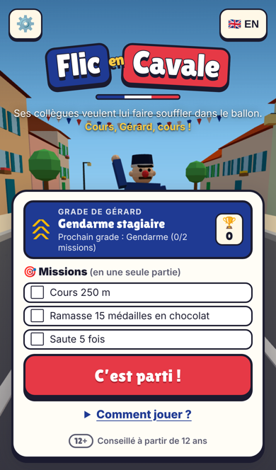
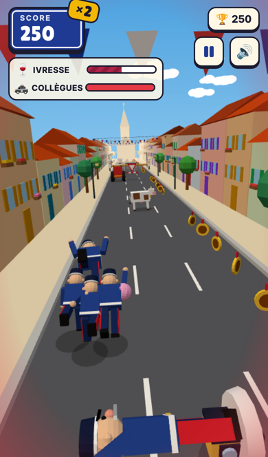
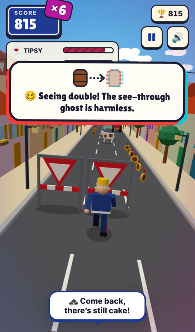
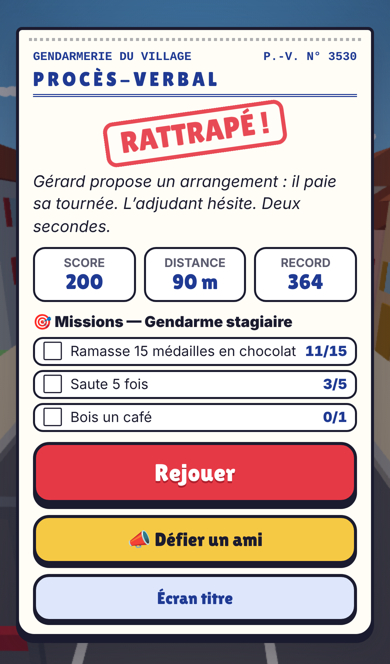

# Critique honnête — FlicEnCavale v1.2 (« Vision double »)

> Session MARKETING, 14/11/2026. Question de l'utilisateur : **« Est-ce que ce jeu, ses graphismes
> et son gameplay vont plaire ? Que peut-on améliorer ? »** Le but de ce document n'est pas de
> vendre le jeu : c'est de dire ce qui marche, ce qui ne marche pas, et ce qui rapporterait le plus.
>
> **Comment je l'ai évalué** : `main` à 7b084f0, joué dans Chromium en émulation **iPhone 13**
> (FR et EN). J'ai fait le tutoriel, plusieurs parties à la main au clavier et avec un petit
> script qui esquive les obstacles, puis forcé l'ivresse pour voir la vision double. J'ai aussi
> lu le code (réglages, textes, partage).
> **Limite importante** : mon émulateur dessine la 3D sans carte graphique, à **~12 images par
> seconde**, contre 60 sur un vrai téléphone. Je ne peux donc **pas juger finement la sensation
> de jeu** (réactivité, difficulté ressentie). Ce point est à vérifier sur un vrai téléphone, avec
> 3 ou 4 personnes qui ne connaissent pas le jeu (voir § 5).

Captures : [`captures/v1.2/`](captures/v1.2/).

| Écran titre | En course | Vision double | Fin de partie |
| --- | --- | --- | --- |
|  |  |  |  |

## Verdict en 5 lignes

1. **C'est un petit jeu propre, drôle et soigné**, nettement au-dessus de la moyenne des jeux web
   amateurs : interface lisible, identité visuelle cohérente (low-poly coloré, fanions, clocher),
   écran de fin « procès-verbal » excellent, valse musette, FR/EN, pause, réglages, installable.
2. **Il va plaire à ton entourage et aux joueurs francophones occasionnels** (le gendarme pompette
   fait sourire immédiatement), **mais tel quel il a peu de chances de percer** sur itch.io ou
   Newgrounds : le « runner à 3 voies » est un genre **très saturé**, et rien, dans la vignette
   ni dans les 30 premières secondes, ne montre ce qui le rend unique.
3. **Son vrai atout est la « vision double »** : c'est une idée originale (l'ivresse rapporte des
   points mais brouille la lecture). Aujourd'hui, elle arrive tard, et à l'écran le fantôme se
   distingue mal du vrai obstacle.
4. **Il manque de raisons de revenir demain** : pas de défi du jour, pas de classement, pas de
   déblocages. Les missions et les grades aident, mais ne suffisent pas.
5. **Il manque de raisons de partager** : le bouton « Défier un ami » existe (très bien), mais le
   lien envoyé ne contient pas le score à battre. L'ami arrive sur l'écran titre, sans défi.

## 1. Qui va aimer, qui va décrocher ?

| Public | Va aimer ? | Pourquoi |
| --- | --- | --- |
| **Proches, collègues, réseau perso** | ✅ Oui | Le pitch fait rire, le jeu est soigné, ils jouent 3-4 parties et en parlent. C'est le public le plus sûr. |
| **Francophones 15-35 ans sur TikTok/Reels** | 🟡 Possible | L'humour « gendarme pompette + village » est très partageable **en vidéo**. Mais ils jouent une ou deux parties puis retournent à Subway Surfers, qu'ils ont déjà : il faut un défi entre amis pour les retenir. |
| **itch.io (navigateurs de jeux web)** | 🟡 Faible à moyen | Public plutôt anglophone, joueurs et créateurs, qui cherche **l'originalité**. Un runner classique passe inaperçu. Un runner où « l'ivresse te fait voir double » peut accrocher, **à condition que la vignette et le GIF le montrent**. |
| **Newgrounds** | 🟠 Risqué | Public anglophone, plus âgé, adepte de l'humour décalé et habitué aux jeux d'arcade : l'humour passera. En revanche, la communauté note sévèrement les jeux « génériques », et un runner sans classement ni médailles y vit peu. |
| **Game Jolt** | 🟡 Faible | Public jeune et anglophone, qui aime les jeux avec un personnage fort et une communauté. Visibilité difficile sans mise à jour régulière. |
| **Enfants (< 12 ans)** | ⛔ Non visé | Le thème alcool l'exclut (âge conseillé 12+, déjà affiché, bien). |

**L'humour « gendarme pompette » fonctionne-t-il hors de France ?**
- **Oui pour la situation** : un policier ivre poursuivi par ses collègues avec un éthylotest,
  c'est compréhensible partout et c'est drôle sans texte. Le **village français** est lui aussi
  reconnaissable de loin (fanions, clocher, baguette, vache) : c'est un atout visuel.
- **Moins pour les blagues écrites** : une grande partie de l'humour passe par les bulles et les
  phrases (« procès-verbal en trois exemplaires », grades…). La version anglaise est adaptée
  (bien), mais un joueur étranger qui ne lit pas les bulles en pleine course voit surtout « un
  runner ». **Il faut davantage d'humour visuel** (animations de chute, réactions des vaches,
  collègues qui trébuchent), qui marche dans toutes les langues et dans les vidéos.

## 2. Premières impressions

**Vignette et titre (sur itch.io, Newgrounds…)**
- « Flic en Cavale » est un bon nom en France ; à l'étranger il est exotique, sans plus. Ça passe
  si la **vignette raconte l'histoire seule** : Gérard au nez rouge, les collègues avec l'éthylotest
  juste derrière, et **un obstacle en double** (le vrai et son fantôme). Aujourd'hui, l'image de
  partage (`og-image.png`) montre bien la poursuite, mais pas la vision double.
- Sur itch.io, une **couverture animée (GIF)** de 3 secondes montrant le dédoublement attirerait
  bien plus de clics qu'une image fixe.

**Les 5 premières secondes**
- ✅ Chargement rapide (titre affiché en ~1,5 s dans mon émulateur, jeu de ~0,7 Mo), bouton
  « C'est parti ! » bien visible, âge conseillé affiché.
- 🟠 L'écran titre est **une grande carte de texte** (grade, 3 missions, comment jouer) qui cache
  la scène et Gérard. Le premier écran ne montre ni le gag ni l'action.
- 🟠 **La première partie est un tutoriel d'environ 40 secondes** : bien fait, mais long pour un
  visiteur venu d'un portail, qui décide en 10 à 20 secondes s'il reste.
- 🟠 **La vision double n'apparaît pas tout de suite** : il faut dépasser 30 % d'ivresse. Le jeu
  démarre justement à 30, et l'ivresse redescend toute seule : un nouveau joueur peut faire
  plusieurs parties sans jamais voir le fantôme.
- 🟠 **Fantôme peu lisible** : sur ma capture (ivresse forcée), le vrai panneau et son double se
  ressemblent beaucoup à l'écran (peu de transparence visible). En plus, la bulle d'explication
  cache le haut de l'écran, jauges comprises.

**Ce qui manque pour partager ou revenir demain**
- Un **lien de défi** : « Kevin a fait 1 234, bats-le », avec un repère du score à battre pendant
  la course.
- Un **défi du jour** (même parcours pour tout le monde) : « t'as fait combien aujourd'hui ? ».
- Un **classement**, même minimal (les classements intégrés de Newgrounds et Game Jolt sont gratuits).
- Des **choses à débloquer** visibles (tenues, képis, moustaches) liées aux grades.

## 3. Ce qu'ont les jeux web du même genre qui marchent (principes, sans copier)

Sur itch.io et Newgrounds, les jeux d'arcade courts qui se font remarquer partagent ces principes :

1. **Un « twist » unique visible en 3 secondes** : une mécanique qu'on comprend sur un GIF.
   Chez nous : la vision double. Elle existe, mais elle est cachée.
2. **Zéro friction** : un clic et on joue ; le tutoriel est intégré à la première course, pas
   avant. Le texte vient après l'action.
3. **Une boucle « encore une partie »** : mort rapide et compréhensible, rejouer en un geste, un
   objectif proche affiché (« plus que 40 m pour ton record »).
4. **Des objectifs externes au score** : médailles/succès de la plateforme, défi quotidien,
   classement. Sur Newgrounds, les médailles et classements intégrés sont un vrai moteur de visites.
5. **Du « juice »** : chaque action a un retour visuel et sonore exagéré (frôlements, combos,
   ralentis, caméra qui secoue). Notre jeu en a déjà une bonne part (bulles, +10, flash du radar).
6. **De la variété dans la durée** : décor ou événements qui changent tous les X mètres, pour que
   la 5e partie ne ressemble pas à la 1re.
7. **Un personnage à forte silhouette**, reconnaissable en miniature. Gérard (nez rouge, képi)
   est sur la bonne voie, mais à l'écran il est de dos et petit.
8. **Des mises à jour régulières et visibles** (devlog, « v1.3 : la fanfare ! ») : sur itch.io et
   Game Jolt, chaque mise à jour remet le jeu en avant.

## 4. Les 10 améliorations, par priorité

Effort : **S** = quelques heures · **M** = 1 à 3 jours · **L** = une semaine ou plus.
Impact : **D** = découverte (attirer) · **R** = rétention (faire revenir) · **P** = partage.

### ⚡ Gains rapides

| # | Amélioration | Impact | Effort | Qui |
| --- | --- | --- | --- | --- |
| 1 | **Montrer la vision double dès la 1re partie** : un verre de rouge garanti vers 10-15 s (ou une ivresse de départ un peu plus haute), pour que chaque nouveau joueur voie le gag. | D, R | S | CODE |
| 2 | **Lien de défi avec le score** : le bouton « Défier un ami » envoie `…?defi=1234`. L'ami voit « Un collègue a fait 1 234, bats-le ! », avec un repère (fanion) à cette distance pendant la course. | P, R | S-M | CODE (+ DESIGN pour le repère) |
| 3 | **Fantôme lisible au premier coup d'œil** : plus transparent, contour pointillé ou scintillement (comme dans le pictogramme de la bulle), et bulle d'explication plus petite qui ne cache pas les jauges. | R | S | DESIGN |
| 4 | **Vignette + GIF « vision double »** pour itch.io, Newgrounds, Game Jolt et l'image de partage ; corriger au passage `og:description`, qui dit encore « tout public » alors que le jeu affiche « 12+ ». | D | S | DESIGN (+ CODE pour les balises) |
| 5 | **Écran titre plus « action »** : la scène et Gérard bien visibles, la carte de missions repliée ou plus petite ; tutoriel découpé en indices **pendant** une vraie course, sans passage obligé de 40 s. | D | S-M | DESIGN + CODE |

### 🏗️ Chantiers moyens

| # | Amélioration | Impact | Effort | Qui |
| --- | --- | --- | --- | --- |
| 6 | **« La patrouille du jour »** : un parcours identique pour tous chaque jour (tirage fixé par la date), avec son propre record et un partage « Patrouille du 14/11 : 1 234 ». | R, P | M | CODE |
| 7 | **Médailles et classements de Newgrounds et Game Jolt** : brancher les missions et les grades sur leurs systèmes intégrés (gratuits, sans serveur à nous). Donne une vraie raison de jouer sur ces sites. | D, R | M | CODE |
| 8 | **Déblocages visibles liés aux grades** : képis, moustaches, tenue de défilé, Gérard en pyjama… affichés sur l'écran titre. Objectif concret pour revenir, et matière à vidéos. | R, P | M | DESIGN + CODE |

### 🧱 Gros chantiers

| # | Amélioration | Impact | Effort | Qui |
| --- | --- | --- | --- | --- |
| 9 | **Variété dans la durée** : zones qui s'enchaînent (place du marché, fête foraine, route de campagne, place de l'église) et événements rares (fanfare, peloton du Tour de France, mariage à la sortie de la mairie). La 10e partie doit surprendre. | R, D | L | DESIGN + CODE |
| 10 | **Plus d'humour visuel, sans texte** : chutes et glissades exagérées, vache qui se retourne, collègues qui trébuchent ou se cognent entre eux, plaquage final en ralenti. Ça marche dans toutes les langues et fait les meilleurs moments de vidéos. | P, D | M-L | DESIGN + CODE |

**Si on ne devait en faire que trois** : n° 1 (montrer le gag), n° 2 (défi avec score) et n° 4
(vignette/GIF). Ce sont les moins chères, et elles touchent à la fois la découverte et le partage.

## 5. Avant d'aller plus loin : un test à 0 € (30 minutes)

Je n'ai pas pu juger la sensation de jeu (émulation à ~12 images/s). Le test le plus utile :
1. Donne ton téléphone à **3 ou 4 personnes qui n'ont jamais vu le jeu**, sans rien expliquer.
2. Note, sans intervenir : combien de temps avant la 1re mort ? Ont-elles compris le fantôme ?
   Ont-elles rejoué **d'elles-mêmes** ? Ont-elles ri, et à quel moment ?
3. Le signal clé est simple : **si 3 personnes sur 4 relancent une partie sans qu'on leur demande,
   le cœur du jeu est bon** et les améliorations ci-dessus valent le coup. Sinon, il faut d'abord
   revoir la difficulté du début (avance de départ sur les collègues, pénalité par choc dans
   `src/config.js`).
